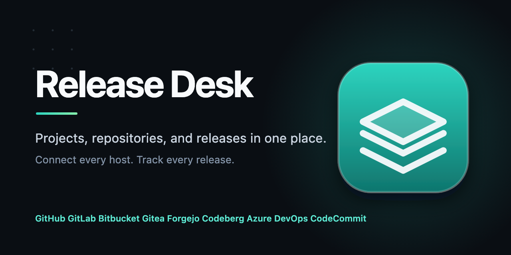

<p align="center">
  
</p>

<h1 align="center">Release Desk</h1>

<p align="center">
  A Rust desktop app for managing projects, repositories, and their releases.
</p>

<p align="center">
  <a href="https://github.com/devenvoy/repo-manager/actions/workflows/ci.yml"></a>
  <a href="LICENSE"></a>
  
  <a href="https://github.com/devenvoy/repo-manager/commits/main"></a>
  <a href="https://github.com/devenvoy/repo-manager/stargazers"></a>
</p>

## Features

- **Project Hub** — create projects, connect repositories, and keep every codebase in one workspace.
- **Multi-provider support** — GitHub, GitLab, Bitbucket Cloud, Gitea, Forgejo, Codeberg, Azure DevOps, AWS CodeCommit, and Gitea-compatible custom servers.
- **Unified releases** — refresh release listings from any connected provider, with the last known listing kept when a request fails.
- **App Store** — a local SQLite catalog of repositories that publish verified desktop installers.
- **Install and update** — install or update macOS DMG releases into the configured Applications directory; other package formats are downloaded to the project's release shelf.
- **Store metadata** — repositories opt in to a store page with a `release-desk-store.json` manifest.

## Requirements

- Rust 1.85 or newer (edition 2024).
- A desktop environment supported by [`gpui`](https://github.com/zed-industries/zed).

## Run

```sh
git clone https://github.com/devenvoy/repo-manager.git
cd repo-manager
cargo run
```

Create projects and select repositories in the Project Hub. The **App Store** reads a local SQLite catalog at `<library_dir>/store/catalog.sqlite3`; opening it does not fetch from the network. Refreshing a project's Releases page updates that project's store records, and the Store's **Refresh** button checks every project online. Failed provider requests keep the last known listing. Install uses a matching file already downloaded in the project's release shelf before contacting a provider.

Project creation accepts GitHub, GitLab, Bitbucket Cloud, Gitea, Forgejo, Codeberg, Azure DevOps, AWS CodeCommit, and Gitea-compatible custom servers. Each host uses its own source discovery adapter. Azure needs an organization URL; Forgejo and custom servers need an HTTPS origin; CodeCommit needs an AWS region and a configured AWS CLI profile. See [provider connections](docs/provider-connections.md) for credentials and source input formats.

## Store metadata

Place `release-desk-store.json` at the root of a cloned repository to supply its store page:

```json
{
  "name": "Example App",
  "description": "A short explanation of what the app does.",
  "category": "Productivity",
  "icon": "assets/icon.png",
  "images": ["assets/screenshot-1.png", "assets/screenshot-2.png"],
  "bundle_name": "Example App.app",
  "show_in_store": true
}
```

Artwork paths are relative to the repository and must resolve to files within it. When `images` is omitted, the store looks for screenshots in conventional `assets/app-store`, `assets/screenshots`, `screenshots`, and `docs/screenshots` locations. Set `show_in_store` to `false` for asset, corpus, or support repositories. The store otherwise lists repositories with a verified desktop installer for the running platform. Release notes come from the connected provider's release description. On macOS, DMG assets can be installed or updated into the configured Applications directory and installed apps can be opened. Other package formats are downloaded to their project's release shelf for manual installation.

See [provider release flows](docs/provider-releases.md) for each provider's artifact source, authentication, and the optional manifest format for hosts without release attachments.

## Documentation

- [Provider connections](docs/provider-connections.md)
- [Provider release flows](docs/provider-releases.md)
- [Development guidance](AGENTS.md)

## Verify

```sh
cargo fmt --check
cargo clippy --all-targets -- -D warnings
cargo test
```

## Contributing

Contributions are welcome. Read [CONTRIBUTING.md](CONTRIBUTING.md) before opening a pull request, and follow the [Code of Conduct](CODE_OF_CONDUCT.md).

## License

Released under the [MIT License](LICENSE).
