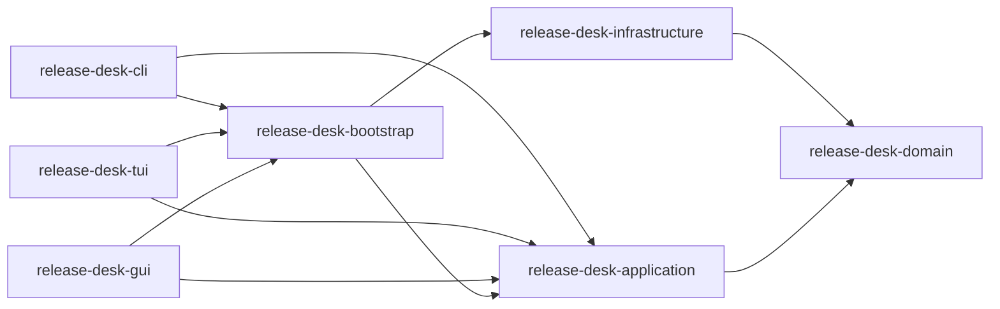

# Release Desk architecture

## Product boundary

One shared core powers a non-interactive CLI, interactive TUI, and native GPUI
desktop application. The user's chosen build order is core → CLI → TUI → GUI.
The current `repo-manager` window is disposable scaffolding: it reads only a
legacy snapshot and owns rules in the view that will move into the core.

The first project links ArtCraft's `.release-desk/data.json` read-only. First
run asks where to put the managed library; new clones, installers, caches, and
backups use that location. The ArtCraft folder is never a write destination.
See [boundaries](BOUNDARIES.md) and [schema](SCHEMA.md).

## Crate map and dependency graph

The arrows indicate *uses*. The domain must have no I/O, GUI, CLI, TUI,
database, network, Git, or OS dependency. Application code depends on domain
types and ports; it never imports a concrete adapter. Infrastructure provides
adapter implementations. A small composition root injects adapters into the
application. Presentations import application APIs and view models only. A CI
check will inspect workspace dependency edges and reject inward imports of
presentation/infrastructure crates.

The existing `release-desk-core` crate is a temporary home for snapshot types
and one release rule. During Phase 2 it will become the pure domain crate or be
replaced without preserving its current public shape. The current root package
will become the GUI crate when Phase 7 is reached. Workspaces may share a
combined executable entry point, but separate binaries remain installable.

## Domain ownership

Entities have stable IDs: project, account, repository, release, asset, pull
request, job, schedule, backup and activity event. Validated value objects
cover project/account names, GitHub IDs, release tags, installer extension,
architecture, file size/checksum, managed relative path, recurrence and
credentials *references*. Domain services select eligible releases, label
architecture, derive repository and installer status, plan retention, decide
import conflicts, and calculate schedules. Every rule is deterministic with
injected time and no filesystem/network reads.

The source sync invariant is: clone if absent, fetch if present, fast-forward
only when the checked-out branch is the default and the working tree is clean,
and never rewrite ahead, diverged, detached, or dirty local work. The status
type distinguishes `not_cloned`, `current`, `behind`, `ahead`, `diverged`,
`dirty`, `detached`, and `error`, with local/remote revisions. The installer
rule excludes drafts, optionally excludes pre-releases, chooses the newest
eligible published release with the requested file type, and tracks per-asset
architecture. These rules are shared by all front ends.

## Application use cases and ports

| Area | Use cases | Required ports |
| --- | --- | --- |
| Projects | Create/validate/rename/duplicate/archive/restore/delete/switch; link snapshot; relocate library | ProjectStore, AccountGateway, Library, LinkedSnapshotSource, Clock |
| Discovery | Discover/paginate, review inbox, track/ignore/bulk update, reconcile rename/transfer | GitHubGateway, ProjectStore, EventSink |
| Source | Inspect state, clone, fetch/fast-forward, update all, open/reveal | GitPort, Library, JobStore, ProjectLock, EventSink |
| Releases/installers | Refresh/cache, select release, download/import, verify, archive/prune, update all | GitHubGateway, DownloadPort, Library, Checksummer, JobStore |
| Pull requests | Refresh/cache/filter/list and open link | GitHubGateway, ProjectStore |
| Jobs/schedules | Queue/cancel/retry/pause/resume, run missed schedule, install background service | JobStore, SchedulerPort, ProjectLock, Clock, Notifier |
| Data | Backup/restore, project/data import/export, diagnostics, health | ArchivePort, Library, ProjectStore, CredentialStore, SystemProbe |

Use cases take explicit validated inputs and return typed outcomes. A
repository ID, not a name, identifies work after rename. The application owns
all status transitions and authorization checks. Adapters report typed errors
with safe context; presentation layers turn them into action-oriented messages.
No raw API response, token, or personal path appears in user-facing diagnostics.

## Jobs and progress

Every long action is a persistent job with an idempotency key, priority,
project/repository association, cancellation token, retry/backoff policy and
structured progress (`phase`, completed/total bytes or items, safe message,
timestamp). The application publishes an event stream; GUI, TUI, and CLI
subscribe without duplicating logic. A bounded queue applies separate network,
Git, disk, and per-project concurrency limits from settings. Backpressure
prevents a thousand-repository refresh from flooding views.

A project-scoped cross-process lock has owner PID/start identity, heartbeat or
lease, and stale-lock recovery. SQLite job state records an interrupted run;
startup reconciliation verifies staged files and resumes or rolls back work.
Cancel and retry are idempotent. No lock is held while awaiting UI events.

## Infrastructure and configuration

- SQLite uses WAL, foreign keys, transactional migrations, backup before
  migration, relative managed paths, and indexed list queries. See
  [SCHEMA.md](SCHEMA.md).
- GitHub GraphQL batches repository/release metadata; REST handles details and
  conditional requests. Both paginate, cache ETags, track quota/reset and
  distinguish offline, authorization, missing, and throttled states.
- Git operations use either a native implementation or system Git behind one
  port. The chosen adapter never puts tokens in process arguments or logs.
- Downloads stream to staging, support resume/cancel/retry, verify size and
  checksum, then atomically install and record the manifest in SQLite. A
  crash-recovery pass reconciles staging and database state.
- Stored secrets live in OS credential storage. `gh` credentials may be
  detected as an input path without persisting their token. PAT/device-flow
  credentials can be assigned per project.
- Config precedence is CLI flag > environment > user config > defaults for
  non-secret settings. Project settings in SQLite override global defaults
  where the product specifies a per-project control. Every effective setting
  has a source label in diagnostics.

## Presentation and release contract

The CLI exercises the entire core first, with human and JSON output, clear
exit codes, dry-run for destructive/large actions, and no prompts when
non-interactive. The TUI subscribes to the same progress stream and restores
the terminal on exit or panic. The GPUI GUI uses the component library for
standard controls, virtualized large lists, native dialogs, accessible focus
order, and no blocking work on the UI thread. It offers system, light, and dark
appearance with purposeful state/progress animation and reduced-motion support.
The full [UX contract](UX-SPEC.md) is a Phase 1 deliverable.

macOS signed and notarized packaging is a release gate. Linux and Windows are
planned build targets. Every milestone updates the
[feature-parity matrix](FEATURE_PARITY.md) and provides test evidence; a static
screen is not accepted as a completed workflow.
