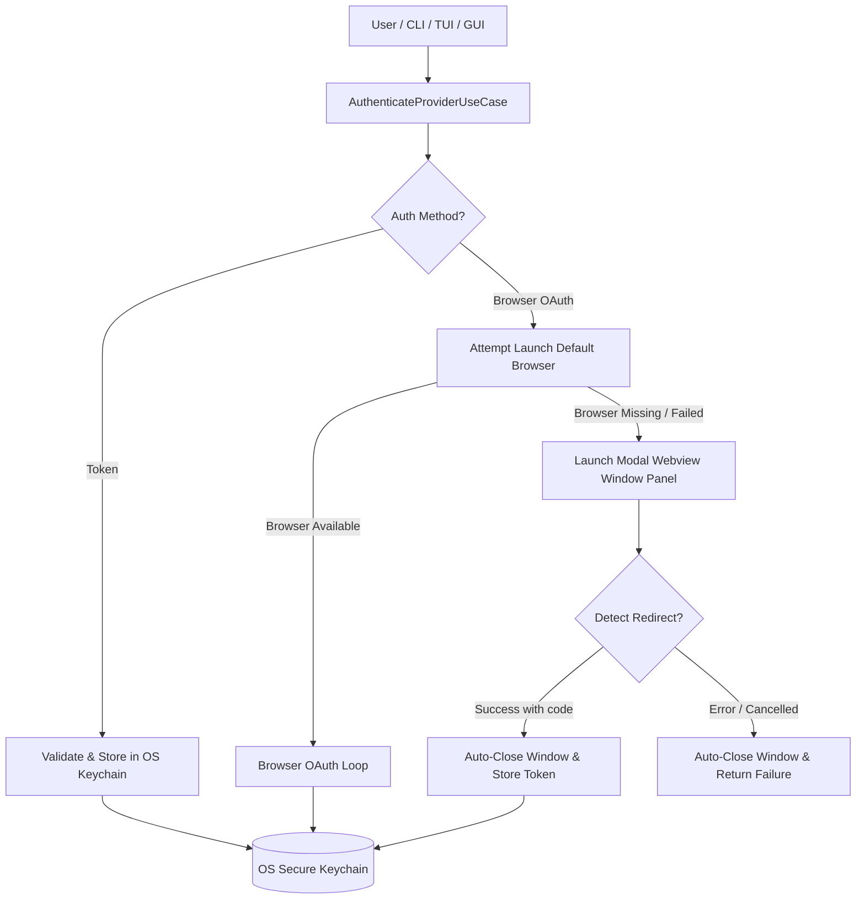

# Multi-Host Git Providers & Authentication Architecture

## Overview

Release Desk supports seamless connectivity across multiple Git hosting providers and flexible authentication modes:

1. **Multi-Host Git Providers**:
   - **GitHub** (`github.com` & GitHub Enterprise)
   - **GitLab** (`gitlab.com` & self-hosted GitLab instances)
   - **Atlassian Bitbucket** (`bitbucket.org` & Bitbucket Data Center)
   - **Custom / Self-Hosted** Git hosts

2. **Dual Authentication Mechanisms**:
   - **Browser-Based OAuth / Web Login**: Automatically launches the system default browser. If no browser is found or if the browser fails to open, it automatically falls back to a custom embedded modal webview window panel that completes authentication and automatically closes on success or failure.
   - **Personal Access Token (PAT) / App Password**: Direct token input for any supported Git host, validated and stored securely in the OS Keychain.

---

## Architecture & Boundaries

### Component Breakdown

1. **Domain Layer (`release-desk-core`)**:
   - [`provider.rs`](file:///Users/devanshpc/Developer/repo%20manager/crates/release-desk-core/src/provider.rs): Defines `GitProviderKind`, `AuthMethod`, `AuthCallbackStatus`, `WebviewWindowSpec`, and `ProviderAccount`.
   - [`port.rs`](file:///Users/devanshpc/Developer/repo%20manager/crates/release-desk-core/src/port.rs): Defines abstract boundaries:
     - `GitHostGateway`: Generic interface implemented by host-specific gateways.
     - `BrowserAuthPort`: Abstract system browser launcher.
     - `WebviewAuthPort`: Abstract modal webview window launcher.
     - `SecretStorePort`: OS Keychain secure storage.

2. **Application Layer (`release-desk-application`)**:
   - [`provider_registry.rs`](file:///Users/devanshpc/Developer/repo%20manager/crates/release-desk-application/src/provider_registry.rs): Thread-safe registry mapping `GitProviderKind` to corresponding `GitHostGateway` adapters.
   - [`use_case/auth.rs`](file:///Users/devanshpc/Developer/repo%20manager/crates/release-desk-application/src/use_case/auth.rs): `AuthenticateProviderUseCase` orchestrates token storage, browser launching, and automatic webview fallback with window lifecycle auto-close.
   - [`event.rs`](file:///Users/devanshpc/Developer/repo%20manager/crates/release-desk-application/src/event.rs): Publishes `AuthStarted`, `AuthFallbackToWebview`, `AuthSucceeded`, and `AuthFailed` events.

3. **Infrastructure Layer (`release-desk-store`)**:
   - [`github_client.rs`](file:///Users/devanshpc/Developer/repo%20manager/crates/release-desk-store/src/github_client.rs): `HttpGitHubGateway` for GitHub REST/GraphQL API.
   - [`gitlab_client.rs`](file:///Users/devanshpc/Developer/repo%20manager/crates/release-desk-store/src/gitlab_client.rs): `HttpGitLabGateway` for GitLab v4 API.
   - [`bitbucket_client.rs`](file:///Users/devanshpc/Developer/repo%20manager/crates/release-desk-store/src/bitbucket_client.rs): `HttpBitbucketGateway` for Atlassian Bitbucket 2.0 API.
   - [`auth/browser_adapter.rs`](file:///Users/devanshpc/Developer/repo%20manager/crates/release-desk-store/src/auth/browser_adapter.rs): `SystemBrowserAuthPort` with system browser execution and missing-browser detection.
   - [`auth/webview_adapter.rs`](file:///Users/devanshpc/Developer/repo%20manager/crates/release-desk-store/src/auth/webview_adapter.rs): `ModalWebviewAuthPort` managing the modal window panel lifecycle, redirect monitoring, and automatic closing on completion.
   - [`credentials.rs`](file:///Users/devanshpc/Developer/repo%20manager/crates/release-desk-store/src/credentials.rs): `OsSecretStore` reading and writing tokens directly to macOS Keychain (`security` CLI / Keychain services).

---

## Verification & Test Matrix

All multi-host and authentication capabilities are verified with dedicated tests:

| Test Identifier | Location | Verified Invariant |
| --- | --- | --- |
| `multi_host_provider_registry_integration` | `multi_host_auth_test.rs` | Register and resolve GitHub, GitLab, and Atlassian Bitbucket gateways |
| `token_authentication_for_multiple_hosts` | `multi_host_auth_test.rs` | Store and retrieve distinct tokens for each provider in OS Keychain |
| `browser_auth_with_automatic_webview_fallback` | `multi_host_auth_test.rs` | When browser is missing, automatically launch webview panel, complete login, auto-close window, emit fallback event |
| `webview_window_closes_on_auth_failure` | `multi_host_auth_test.rs` | On denied or failed authentication, window panel is closed immediately and returns typed failure |
| `webview_navigation_extracts_code_and_closes` | `auth/webview_adapter.rs` | Redirect navigation extraction parses OAuth code and closes window |
| `parse_provider_kinds` | `release-desk-core/provider.rs` | Normalized parsing for github, gitlab, bitbucket, and atlassian aliases |
