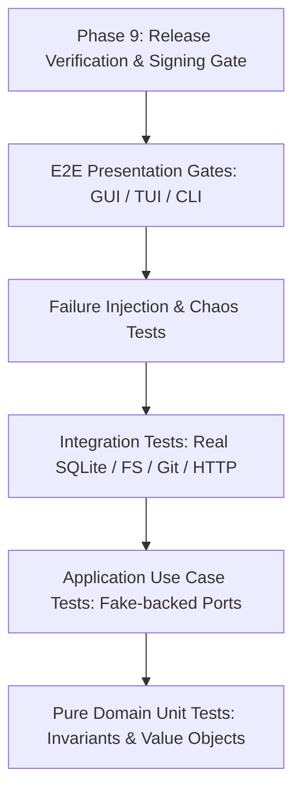

# Release Desk Verification & Test Strategy

> **Requirements**: SHIP-01, PAR-01, ARC-01  
> **Traceability**: All 23 requirement IDs mapped across test levels, execution phases, and release gates.

---

## 1. Test Pyramid & Methodology



1. **Pure Domain Unit Tests (Phase 2)**:
   - 100% deterministic, no I/O, no network, zero external dependencies.
   - Injected clock/time and value object validation.
   - Enforce domain rules: safe fast-forward only, release selection by publication date, arch detection, installer state derivations.

2. **Application Use Case Tests (Phase 3)**:
   - In-memory fakes for every port (`ProjectStore`, `GitPort`, `GitHubGateway`, `DownloadPort`, `JobStore`, `SecretStorePort`).
   - Verifies state transitions, cancellation tokens, job priorities, and progress events.
   - Bounded concurrency and idempotency testing.

3. **Infrastructure Integration Tests (Phase 4)**:
   - Real SQLite WAL database instances with schema migrations.
   - Temporary local filesystem trees and sandboxed system Git repositories.
   - Strict capability boundary enforcement: tests prove write operations reject canonical ArtCraft paths and symlink traversals.
   - Wiremock / recorded GitHub GraphQL and REST API responses with ETag caching and rate limit resets.

4. **Failure-Injection & Resilience Tests (Phase 4 & 5)**:
   - Interrupted network downloads, corrupted partial files, killed processes holding locks.
   - Stale process lock recovery and database rollback on migration error.
   - Read-only filesystem simulations and missing external volumes.

5. **Presentation Contract Tests (Phases 5, 6, 7)**:
   - **CLI**: Executable subprocess runs testing exit codes, stdout/stderr formatting, JSON flags, and `--dry-run`.
   - **TUI**: Virtual terminal emulator tests verifying key navigation, resize handling, mouse interactions, and terminal restoration on exit.
   - **GUI**: GPUI view-model tests and running-window interactive review for System/Light/Dark modes and reduced motion.

6. **Migration & Parity Gates (Phase 8 & 9)**:
   - Automated checks against `docs/FEATURE_PARITY.md`.
   - Migration of legacy `.state/*.manifest` files and verification that legacy ArtCraft folders remain byte-for-byte identical.

---

## 2. Requirement-to-Test Traceability Matrix

| Requirement ID | Description | Phase | Test Type | Verification Method & Test Identifier |
|---|---|---|---|---|
| **PAR-01** | Full Legacy Parity | 1, 9 | Review / E2E | `docs/FEATURE_PARITY.md` row coverage check; parity test suite `test_parity_coverage` |
| **ARC-01** | Architecture Boundaries | 1–4 | Unit / Linter | `cargo-deny` / dependency edge lint rejecting inward crate imports; `test_architecture_boundary` |
| **PROJ-01** | Multi-Project Management | 2–5, 7 | Unit / Use Case / CLI | `test_project_crud`, `test_project_name_validation`, `cli::test_project_commands` |
| **PROJ-02** | Library Root & ArtCraft Boundary | 4, 5, 7 | Integration / Safety | `test_artcraft_read_only_boundary`, `test_library_relocation_verification` |
| **REPO-01** | Discovery, Tracking, Filters | 3–5, 7 | Use Case / Integration | `test_repo_discovery_pagination`, `test_tracking_switches_independence` |
| **GIT-01** | Safe Fast-Forward Sync | 2–5, 7 | Unit / Integration | `test_git_clean_ff_only`, `test_git_diverged_ahead_dirty_untouched` |
| **GIT-02** | Concurrent Guarded Git Sync | 3–5 | Integration / Stress | `test_concurrent_git_sync`, `test_git_cancellation_and_backoff` |
| **REL-01** | Release Selection & Asset Grouping | 2–5, 7 | Unit / Use Case | `test_release_selection_published_at`, `test_arch_label_extraction` |
| **INST-01** | Atomic Resumable Downloads & Shelf | 2–5, 7 | Integration / Chaos | `test_atomic_installer_staging`, `test_resumable_download_checksum` |
| **PR-01** | Pull Request Caching & Filters | 4–7 | Integration / UI | `test_pr_fetch_and_cache`, `test_pr_state_filtering` |
| **AUTH-01** | Multi-Auth & OS Secret Store | 4, 5, 7 | Security / Integration | `test_os_keychain_storage`, `test_no_secrets_in_logs_or_db` |
| **OFF-01** | Full Offline Usability & Age Labels | 3–7 | Integration / UI | `test_offline_data_availability`, `test_stale_cache_age_label` |
| **JOB-01** | Shared Job Queue & Concurrency | 3–7 | Use Case / Concurrency | `test_job_queue_priorities`, `test_job_idempotency_and_cancellation` |
| **SCHED-01** | Per-Project Scheduler & Service | 4–7 | Integration / Service | `test_interval_scheduler`, `test_os_daemon_registration` |
| **DATA-01** | Versioned SQLite & Migrations | 4 | Integration / Migration | `test_sqlite_wal_pragmas`, `test_forward_migrations_with_backup` |
| **BACK-01** | Portable Backup & Restore | 4–7 | Integration / Verification | `test_backup_archive_integrity`, `test_restore_with_safety_snapshot` |
| **CLI-01** | Complete Scriptable CLI | 5 | E2E CLI | `tests/commands.rs` running all subcommands with `--json` and `--dry-run` |
| **TUI-01** | Interactive Terminal Client | 6 | E2E Terminal | `test_tui_keybindings`, `test_terminal_restoration_on_panic` |
| **GUI-01** | GPUI Native Desktop Application | 7 | Visual / Interaction | Running window visual checklist across 8 workspace screens |
| **GUI-02** | Design System, Themes & Motion | 7 | Visual Review | System/Light/Dark mode audit and Reduced Motion compliance |
| **MIG-01** | Legacy ArtCraft Read-Only Link | 4, 8 | Integration / Safety | `test_legacy_snapshot_read_only_hash_preservation` |
| **OPS-01** | Diagnostics, Logs & Health Checks | 4–7 | System / Security | `test_system_health_checks`, `test_redacted_diagnostics_export` |
| **SHIP-01** | Release Verification & Packaging | 9 | Packaging / Release Gate | Signed & notarized macOS `.dmg` verification; clean-room install test |

---

## 3. Mandatory CI Quality Gates

Before any phase is marked complete or merged:
```bash
cargo fmt --check
cargo clippy --all-targets -- -D warnings
cargo test --all-targets
```

## 4. Phase 9 Final Release Gate
- macOS bundle is packaged as `.dmg` or `.app`.
- Binary code-signed and notarized via Apple Notary Service (credentials supplied at release time).
- Clean-room install on fresh macOS system tests full first-run flow, ArtCraft read-only linking, and library creation.
