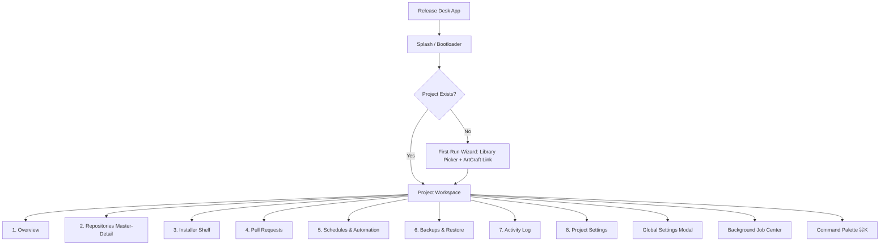

# Release Desk Desktop UX Specification

> **Requirements**: GUI-01, GUI-02, PAR-01  
> **Framework**: GPUI + GPUI Component Kit  
> **Visual Identity**: Modern native macOS aesthetic with System, Light, and Dark appearance modes, purposeful subtle motion, and full reduced-motion accessibility.

---

## 1. Information Architecture & Navigation

Release Desk is organized around two primary presentation contexts:
1. **Application Shell & Window Controls**: Titlebar, Project Switcher, Global Settings, System Status/Quota, and Background Job Tray Indicator.
2. **Project Workspace**: 8 tabbed views with responsive layouts and fluid transitions:
   - **Overview**: High-level dashboard with repository summary counts, pending updates, sync health, and quick actions.
   - **Repositories**: Master-detail repository browser with search, multi-select, filters, and detailed inspectors.
   - **Installers**: The "Installer Shelf" displaying current releases, local downloads, per-architecture assets, and update-all workflows.
   - **Pull Requests**: Pull request browser with state filters (Open, Merged, Closed, Draft), author, labels, and external browser links.
   - **Schedules**: Automated job scheduler (sync, release check, backups) with recurrence rules and execution history.
   - **Backups**: Portable archive creation, import, export, and verification center.
   - **Activity Log**: Searchable structured event trail with correlation IDs, error details, and log export.
   - **Project Settings**: Project-scoped preferences (credentials, auto-sync, pre-release inclusion, retention count, ignored repos).

---

## 2. Visual Design System & Themes

### 2.1 Theme Modes & Tokens
The application supports **System**, **Light**, and **Dark** modes, automatically responding to OS appearance changes.

| Token | Light Theme | Dark Theme | Purpose |
|---|---|---|---|
| `bg.canvas` | `#F6F8FA` | `#0D1117` | Main window background |
| `bg.surface` | `#FFFFFF` | `#161B22` | Cards, panels, detail views |
| `bg.sidebar` | `#F0F2F5` | `#090D13` | Left navigation rail |
| `bg.muted` | `#EAEEF2` | `#21262D` | Hover states, table headers, code blocks |
| `fg.primary` | `#1F2328` | `#F0F6FC` | Headings, primary labels, values |
| `fg.muted` | `#656D76` | `#8D96A0` | Secondary descriptions, timestamps |
| `border.subtle` | `#D0D7DE` | `#30363D` | Card borders, dividers, separators |
| `accent.primary` | `#0969DA` | `#2F81F7` | Primary buttons, active indicators |
| `accent.hover` | `#0854B2` | `#388BFD` | Primary button hover |
| `status.success` | `#1A7F37` | `#238636` | Up to date, verified, current |
| `status.warning` | `#9A6700` | `#D29922` | Update available, needs pull, missing |
| `status.danger` | `#CF222E` | `#F85149` | Sync error, diverged, failed job |

### 2.2 Typography
- **UI Font**: System default (`.SF NS` on macOS, system font on Linux/Windows).
- **Monospace Font**: System monospace (`SF Mono`, `Menlo`, `Cascadia Code`).
- **Scale**:
  - `Display`: 24px / 32px (Semibold) — Screen headlines
  - `Title`: 18px / 24px (Semibold) — Card headers, modal titles
  - `Body`: 13px / 18px (Regular) — General UI labels, descriptions
  - `Caption`: 11px / 14px (Regular) — Timestamps, badges, secondary hints
  - `Code`: 12px / 16px (Mono) — Commits, paths, command strings

### 2.3 Motion & Transitions
- **Durations**: Fast (100ms) for hover/press, Medium (200ms) for dialogs/drawers, Smooth (300ms) for progress bars.
- **Easing**: Standard `cubic-bezier(0.16, 1, 0.3, 1)` (out-expo).
- **Reduced Motion Support**: When OS "Reduce Motion" is enabled, all slide and expand animations become instant opacity fades (0ms duration).

---

## 3. Screen Specifications & State Matrix

Every view strictly implements all required state variants without placeholder UI.

### 3.1 Splash & First-Run Wizard
- **Entry Point**: App launch when uninitialized or initializing.
- **Primary Action**: Select Library Folder and Confirm Link.
- **State Variants**:
  - *Loading*: Verifies database migrations, resolves library folder, and loads credentials with progress spinner.
  - *First-Run Link*: Displays path picker for managed library root; auto-detects `/Volumes/Devansh2/codes/ArtCraft/.release-desk/data.json` as read-only linked source; warns if user attempts to choose ArtCraft folder as library.
  - *Corrupt / Locked DB*: Shows explicit recovery choices: "Unlock Project", "Restore from Automatic Backup", or "Choose Different Library".
  - *Offline*: Loads cached snapshot immediately with stale time indicator.
- **Shared Use Case**: `InitializeFirstRun`, `OpenLibrary`, `RecoverDatabase`.

### 3.2 Repositories Master-Detail View
- **Entry Point**: Workspace "Repositories" Tab (`⌘1`).
- **Primary Action**: Search, Filter, and Inspect Repository Details.
- **Layout**: Two-column master-detail layout (Left: virtualized list with search and filters; Right: detail inspector).
- **State Variants**:
  - *Loading*: Skeleton shimmer cards in rail list.
  - *Success (Empty)*: "No repositories match filter" with clear filter button.
  - *Success (Populated)*: Virtualized rows capable of 1,000+ repos. Row displays app icon, repo name, visibility badge, Git status chip (`Behind`, `Current`, `Ahead`, `Diverged`, `Dirty`), latest release tag, and DMG status chip.
  - *Detail Pane*: Displays full metadata, clone path, branch selector, "Sync Clone" button, "Open in Terminal" button, "Reveal in Finder" button, and expandable release history.
  - *Error*: Banner stating network or Git failure with "Retry" action.
- **Shared Use Case**: `ListRepositories`, `FilterRepositories`, `InspectCloneState`, `SyncRepositorySource`.

### 3.3 Installer Shelf View
- **Entry Point**: Workspace "Installers" Tab (`⌘2`).
- **Primary Action**: Download Updates or Add External DMGs.
- **Layout**: 3-column comparative shelf grid:
  - Column 1: **Newest on GitHub** (Tag, date, asset list with architecture chips: Apple Silicon / Intel / Universal).
  - Column 2: **On the Shelf** (Active installed file, size, checksum verification status).
  - Column 3: **Previous Build** (Archived previous build in `old/` for rollback).
- **State Variants**:
  - *Header Actions*: "Download All Updates (N)", "Add Downloaded DMGs", and "Change Shelf Folder".
  - *In-Progress Transfer*: Live animated progress bar showing byte count, speed (MB/s), ETA, and stage name.
  - *Drag-and-Drop*: Whole window highlights on drag-over; dropping `.dmg` files initiates matching and verification.
  - *Empty State*: "No releases with installer assets found".
- **Shared Use Case**: `ViewInstallerShelf`, `DownloadAllPendingInstallers`, `ImportInstallerFile`, `VerifyInstallerAsset`.

### 3.4 Pull Requests View
- **Entry Point**: Workspace "Pull Requests" Tab (`⌘3`).
- **Primary Action**: Filter by State (Open, Merged, Closed, Draft) and open in web browser.
- **State Variants**:
  - *Filters*: Segmented buttons for All, Open, Merged, Closed with live count badges.
  - *PR Item*: Displays title, PR number, author avatar/login, source/target branch badges, labels with custom GitHub colors, and relative timestamp.
  - *Empty State*: "No open pull requests in tracked repositories".
  - *Offline State*: Displays cached PRs with warning chip "Showing cached PRs from [date]".
- **Shared Use Case**: `ListRepositoryPullRequests`, `FilterPullRequests`, `SyncPullRequests`.

### 3.5 Schedules & Automation View
- **Entry Point**: Workspace "Schedules" Tab (`⌘4`).
- **Primary Action**: Create or edit scheduled sync and backup jobs.
- **State Variants**:
  - *Schedule Cards*: Frequency picker (Every N hours, Daily at HH:MM, Weekly, Monthly), target actions (Sync metadata, Fast-forward clones, Check installers, Take backup).
  - *Status Indicator*: Active, Paused, or Missing background daemon with one-click "Register Background Service".
  - *Execution History*: Table of recent runs with timestamp, duration, items processed, and exit status.
- **Shared Use Case**: `ListSchedules`, `CreateSchedule`, `UpdateSchedule`, `RegisterDaemonService`.

### 3.6 Backups & Restore View
- **Entry Point**: Workspace "Backups" Tab (`⌘5`).
- **Primary Action**: "Create Backup Archive" and "Restore Backup".
- **State Variants**:
  - *Create Modal*: Checkboxes for including database, settings, cloned source (with disk size calculation), and installers.
  - *Restore Modal*: Archive file picker, pre-flight integrity check, conflict preview, and safety backup creation before overwrite.
  - *Integrity Verification*: Displays SHA-256 hash, entry count, and encryption status.
- **Shared Use Case**: `CreateBackupArchive`, `RestoreBackupArchive`, `VerifyBackupArchive`.

### 3.7 Activity Log & Diagnostics View
- **Entry Point**: Workspace "Activity" Tab (`⌘6`).
- **Primary Action**: Search logs, filter by level (Info, Warn, Error), and Export Diagnostics.
- **State Variants**:
  - *Log Stream*: Real-time scrolling virtualized log with level badges and JSON detail drawers.
  - *Redacted Export*: "Export Redacted Diagnostics" button generating ZIP bundle stripped of secrets and tokens.
  - *System Health*: Status cards for Git version, SQLite WAL integrity, OS credential store, and disk space.
- **Shared Use Case**: `ListActivityEvents`, `ExportDiagnostics`, `RunHealthCheck`.

### 3.8 Global & Project Settings
- **Entry Point**: Gear Icon in sidebar (`⌘,`).
- **Sections**:
  - *Storage*: Managed library root path, relocation tool with safety copy and verification.
  - *Accounts & Credentials*: PAT management, Device Flow sign-in, `gh` token import, scope verification.
  - *Appearance*: System / Light / Dark radio buttons, Reduced Motion toggle.
  - *Network & Transfers*: Concurrency limits (1–8), bandwidth throttling, proxy configuration.
  - *Releases*: Pre-release inclusion toggle, installer file extension filter (`dmg`, `zip`, `pkg`, etc.).
- **Shared Use Case**: `LoadSettings`, `SaveSettings`, `RelocateLibraryRoot`, `ManageCredentials`.

---

## 4. Keyboard Shortcuts & Accessibility

| Shortcut | Scope | Action |
|---|---|---|
| `⌘K` / `Ctrl+K` | Global | Open Command Palette |
| `⌘,` | Global | Open Settings |
| `⌘1` – `⌘8` | Workspace | Switch Workspace Tabs |
| `⌘R` / `F5` | Workspace | Force Refresh Metadata |
| `⌘U` | Installers | Download All Updates |
| `⌘⇧S` | Repositories | Sync All Git Clones |
| `⌘F` | Repositories / Logs | Focus Search Bar |
| `↑` / `↓` / `J` / `K` | Master List | Navigate List Items |
| `Enter` | Master List | Open Selected Item |
| `Space` | Master List | Toggle Tracked Checkbox |
| `Escape` | Modal / Palette | Close Overlay |

---

## 5. Large Dataset & Scalability Targets
- **ArtCraft Catalog**: 66 repositories, 400+ releases, 14 desktop apps rendered with immediate responsiveness.
- **Large Organization Target**: Smooth 60fps scrolling and instant filtering on **1,000+ repositories**. Virtualized viewport renders only visible DOM rows plus 5 buffer rows.
- **Memory Footprint**: Sub-100MB resident memory during steady state; zero memory accumulation during background polling.
