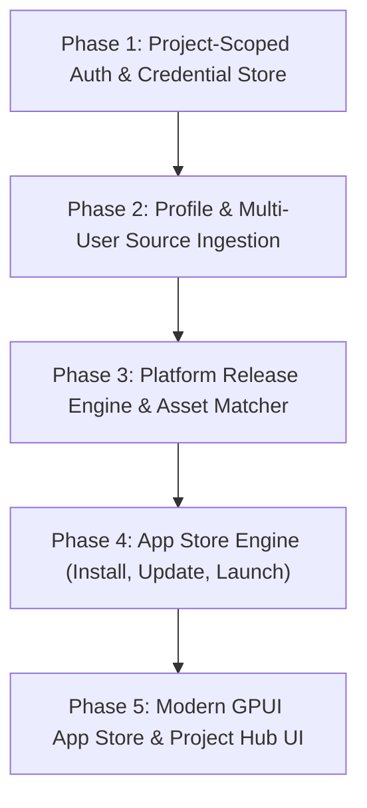

# Release Desk: Product Vision & Architecture Roadmap

> **Vision Alignment**: Transitioning Release Desk from a repository sync tool into a **Project-Centric Git Fleet Manager & Unified Local App Store**.

---

## 1. The Core Vision Breakdown

Your vision unifies two powerful concepts into one cohesive desktop experience:

```
┌────────────────────────────────────────────────────────────────────────────────────────┐
│                                 RELEASE DESK DESKTOP                                   │
├────────────────────────────────────────────────────┬───────────────────────────────────┤
│ 📂 PROJECTS WORKSPACE                              │ 🛍️ LOCAL APP STORE               │
│                                                    │                                   │
│ • Each Project = 1 Local Directory on disk        │ • Aggregates apps across ALL      │
│ • Project-Scoped Auth (Project A -> GitHub PAT 1;  │   projects in your workspace      │
│   Project B -> GitLab Token 2; Project C -> OAuth) │ • Real App Icons & Screenshots    │
│ • Multi-User Ingestion: Add profile links or       │ • One-Click Install to Mac        │
│   usernames -> fetch profile & repos               │ • One-Click Update when new       │
│ • Checkbox selector: Choose which public/private   │   release tags drop               │
│   repos to clone and manage                        │ • "Open" button when up-to-date   │
│ • Multi-Platform Release Shelf (DMG, EXE, ZIP)     │ • Real changelogs & release notes │
└────────────────────────────────────────────────────┴───────────────────────────────────┘
```

---

## 2. Key Architectural Pillars

### Pillar A: Project-Scoped Authentication & Directory Isolation
- **Disk Binding**: A Project points to **one folder on disk** (e.g. `~/Developer/ArtCraft` or `/Volumes/Work/Tools`).
- **Independent Security**: Authentication credentials belong to the **Project**, not globally.
  - Project A (Work) connects to **GitHub Enterprise** with Token A.
  - Project B (Open Source) connects to **GitLab** with Token B.
  - Project C (Personal) connects via **System Browser OAuth**.
- Tokens are stored encrypted in the OS Keychain tagged per `project_id`.

### Pillar B: Multi-User / Multi-Profile Ingestion
- Inside a single Project, the user can configure **multiple source profiles**:
  - Input: Enter `@torvalds` or `https://github.com/storytold` or `https://gitlab.com/group/subgroup`.
  - Extraction: The app parses the profile link, verifies the host, and queries the user/org profile (avatar, bio, public repo count).
  - Repository Selection Grid:
    - Lists all available repositories with description, primary language, star count, and private/public badge.
    - Checkbox UI: Select All or cherry-pick specific repositories to clone.
  - Ingestion executes into the project directory (either grouped by user folder or flat structure).

### Pillar C: Platform-Smart Release Shelf
- Analyzes GitHub/GitLab releases and matches assets to the user's host OS:
  - **macOS**: Prefers `.dmg` or `.pkg` (distinguishing Apple Silicon `aarch64`/`arm64` vs Intel `x86_64`).
  - **Windows**: Prefers `.exe` or `.msi` installers.
  - **Linux**: Prefers `.AppImage`, `.deb`, `.rpm`, or `.tar.gz`.
- Allows toggling to view all formats or cross-platform binaries.

### Pillar D: The Unified Local App Store
The crowning jewel of the app:
- Scans all projects for release assets that are runnable applications.
- **Rich Metadata Extraction**:
  - Extracts the real app icon (from `.icns` inside DMG, repo `icon.png`, `logo.svg`, or GitHub release assets).
  - Extracts banner images, screenshots from README/releases, and formatted Markdown changelogs.
- **App Store Card**:
  - Shows App Icon, Title, Version Tag, Category/Project badge, and Size.
- **Dynamic 3-State Action Button**:
  - 📥 **Install**: Automatically downloads the `.dmg`, mounts it, copies the `.app` bundle to `~/Applications` (or `/Applications`), and unmounts. Zero manual dragging needed.
  - 🔄 **Update**: When a newer release tag is detected on Git, the button switches to "Update" with release notes highlights.
  - ▶️ **Open**: When installed and matching the latest release version, clicking immediately launches the native app!

---

## 3. Implementation Roadmap



### Phase 1: Project-Scoped Multi-Provider Authentication
- Enhance SQLite schema to bind credentials to `project_id`.
- Support multiple distinct accounts across GitHub, GitLab, and Bitbucket.
- Secure token storage with project isolation in macOS Keychain.

### Phase 2: Multi-User Ingestion & Repo Picker
- Implement URL parser and profile metadata scraper (fetches user profile picture, name, repo catalogue).
- Build the **Repository Picker Modal**: Select All / Select Individual with live search and filter.
- Clone orchestrator maintaining `<clone_dir>/<user>/<repo>` or configurable layout.

### Phase 3: Smart Platform Release Engine
- Parse semantic versions and release assets.
- Detect application packages (`.dmg`, `.pkg`, `.app.zip`, `.exe`).
- Extract changelogs, publication timestamps, and architecture targets.

### Phase 4: The 1-Click App Store Engine
- **DMG Handler**: Mount DMG headless via `hdiutil`, extract `.app` into `~/Applications`, and unmount.
- **App Detection**: Check `~/Applications` and `/Applications` using `NSWorkspace` / bundle IDs to detect installed version.
- **Launcher**: Execute installed application via native macOS APIs (`open -a`).

### Phase 5: GPUI App Store Presentation
- Re-architect the GUI with a top navigation bar:
  - 🛍️ **App Store**: Grid of apps, search, categories, install/update/open cards, and detail modal.
  - 📁 **Projects**: Dashboard of your projects, directory locations, and multi-user sources.
  - ⚙️ **Settings**: Appearance, download directory, and credentials.
