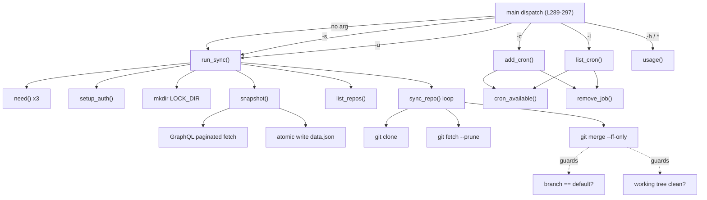

# Shell Reference Inventory — `storytold-sync.sh`

> **Source**: `/Volumes/Devansh2/codes/ArtCraft/storytold-sync.sh` (297 lines)
>
> **Audited**: 2026-10-27 — exhaustive, read-only audit.

---

## Summary

The script is a GitHub-organization repo syncer. It uses one GraphQL call per 50 repos
to build a `data.json` snapshot consumed by a companion `release-desk.html` web page,
then clones/fast-forwards every non-archived repo locally. It also has interactive
cron-job management (add/list/remove).

---

## Feature Inventory

| ID | Category | Function / Location | Description | Active? | Key Implementation Details |
|---|---|---|---|---|---|
| **SH-001** | Command | `run_sync` (L147-175), main dispatch `""` (L290) | **Default sync** — full repo sync: snapshot + clone/fetch all repos. Top-level entry point when the script is invoked with no arguments. | ✅ Active | Calls `need`, `setup_auth`, acquires lock, calls `snapshot`, `list_repos`, iterates `sync_repo`. Logs start/finish with repo count. |
| **SH-002** | Command | main dispatch `-s\|--snapshot` (L291) | **Snapshot-only mode** — sets `ONLY_SNAPSHOT=1` and calls `run_sync`, which returns after `snapshot()` without cloning/fetching. | ✅ Active | Environment variable `ONLY_SNAPSHOT` checked at L162; short-circuits `run_sync`. |
| **SH-003** | Command | main dispatch `-u\|--ui` (L292) | **UI mode** — full sync, then opens `release-desk.html` in the system browser. | ✅ Active | Uses `open` (macOS) with `xdg-open` fallback (Linux). Path is `$SCRIPT_DIR/release-desk.html`. |
| **SH-004** | Command | `add_cron` (L182-229), main dispatch `-c\|--add-cron` (L293) | **Add cron job** — interactive wizard to schedule this script via `crontab`. | ✅ Active | Prompts for frequency (1-4) and time (HH:MM). Generates unique job ID. Appends to crontab and `$JOBS_FILE`. |
| **SH-005** | Command | `list_cron` (L244-284), main dispatch `-l\|--list-cron` (L294) | **List/remove cron jobs** — shows all jobs tracked by the script, with option to remove one or all. | ✅ Active | Reads `$JOBS_FILE`, cross-checks against `crontab -l` to detect MISSING status. Prompts for removal. |
| **SH-006** | Command | `usage` (L41-54), main dispatch `-h\|--help` and `*` (L295-296) | **Help / usage text** — prints usage and env overrides. Unknown flags also trigger usage + `exit 1`. | ✅ Active | Lists all options and env vars: `STORYTOLD_ORG`, `STORYTOLD_BASE_DIR`, `GITHUB_TOKEN`. |
| **SH-007** | API Call | `snapshot` (L94-116) | **GitHub GraphQL API — paginated org repos + releases** — fetches all repos for an org with releases and assets, 50 at a time. | ✅ Active | Endpoint: `https://api.github.com/graphql`. Auth: `Bearer $TOKEN`. Pagination via `hasNextPage` / `endCursor`. Uses `jq` to compose request JSON and merge pages. Writes `$DATA_FILE`. |
| **SH-008** | API Call | `api_get` (L80-85) | **GitHub REST API helper** — generic GET for any REST endpoint. | ❌ **Dead code** | Defined but never called anywhere in the script. Uses `curl -fsSL` with auth headers and API version `2022-11-28`. Endpoint: `https://api.github.com/$1`. |
| **SH-009** | Data Format | GraphQL query `GQL` (L87-91) | **GraphQL query string** — fetches org repos with metadata, default branch, and up to 6 releases with 30 assets each. | ✅ Active (used by `snapshot`) | Fields: `name`, `description`, `url`, `isPrivate`, `isArchived`, `pushedAt`, `primaryLanguage`, `defaultBranchRef` (name + OID), `releases` (name, tagName, description, isDraft, isPrerelease, publishedAt, createdAt, url, releaseAssets: name/size/downloadUrl). Ordered by `PUSHED_AT DESC`. |
| **SH-010** | Data Format | `snapshot` output (L111-113) | **`data.json` schema** — merged JSON written to `$DATA_FILE`. | ✅ Active | Top-level keys: `org` (string), `generated` (ISO 8601 UTC timestamp), `repos` (array of repo objects from GraphQL). Atomic write via `$DATA_FILE.new` → `mv`. |
| **SH-011** | Data Format | `JOBS_FILE` records (L26, L218) | **Cron jobs file format** — pipe-delimited text file. | ✅ Active | Format: `id\|label\|cron_expr\|created_at`. One line per job. File: `$STATE_DIR/cron_jobs.txt`. |
| **SH-012** | Git Operation | `sync_repo` clone branch (L127-129) | **`git clone`** — clones a repo that doesn't exist locally. | ✅ Active | `git $GIT_AUTH clone -q "$url" "$dir"`. Auth injected via `-c http.extraHeader`. Quiet mode. Logs failure but does not abort the loop (returns). |
| **SH-013** | Git Operation | `sync_repo` fetch branch (L132-133) | **`git fetch --prune`** — fetches remote changes and prunes dead remote-tracking branches. | ✅ Active | `git -C "$dir" $GIT_AUTH fetch -q --prune origin`. Quiet mode. Logs failure, returns without aborting. |
| **SH-014** | Git Operation | `sync_repo` fast-forward (L136-142) | **`git merge --ff-only`** — fast-forwards the default branch if safe. | ✅ Active | **Safety guards**: (1) current branch must equal `$branch` (default branch), (2) working tree must be clean (`git status --porcelain` is empty). Merges `origin/$branch`. Logs success or skip. |
| **SH-015** | Git Operation | `sync_repo` branch check (L137) | **`git branch --show-current`** — determines current branch. | ✅ Active | Used in the fast-forward safety gate. Stderr suppressed; falls back to empty string on failure. |
| **SH-016** | Git Operation | `sync_repo` clean check (L138) | **`git status --porcelain`** — checks for uncommitted changes. | ✅ Active | Must return empty for fast-forward to proceed. Prevents overwriting local modifications. |
| **SH-017** | State/Status | `list_repos` (L118-120) | **Parse snapshot for repo list** — extracts non-archived repos from `data.json`. | ✅ Active | Uses `jq` to filter `isArchived == false`. Returns TSV: `name\tclone_url\tdefault_branch`. Falls back to `"main"` if `defaultBranchRef.name` is null. Clone URL constructed as `url + ".git"`. |
| **SH-018** | State/Status | `list_cron` status check (L260) | **Cron job status detection** — cross-references `$JOBS_FILE` entries against `crontab -l` output. | ✅ Active | Status is `"ACTIVE"` if the comment tag `# storytold-sync:$id` is found in the crontab; otherwise `"MISSING in crontab"`. |
| **SH-019** | Configuration | `ORG` (L23) | **GitHub org name** — configurable via `STORYTOLD_ORG` env var. | ✅ Active | Default: `storytold`. |
| **SH-020** | Configuration | `BASE_DIR` (L24) | **Base directory for cloned repos** — configurable via `STORYTOLD_BASE_DIR` env var. | ✅ Active | Default: `$SCRIPT_DIR` (directory containing the script). |
| **SH-021** | Configuration | `STATE_DIR` (L25) | **Persistent state directory** — `$HOME/.storytold-sync`. | ✅ Active | Created at startup (`mkdir -p`). Contains `cron_jobs.txt`, `sync.log`, `env`, `.lock/`. |
| **SH-022** | Configuration | `ENV_FILE` (L28) | **Optional env file** — `$STATE_DIR/env`, sourced at auth setup. | ✅ Active | Expected to contain `export GITHUB_TOKEN=...`. Sourced with `. "$ENV_FILE"` in `setup_auth`. |
| **SH-023** | Configuration | `LOG_FILE` (L27) | **Sync log file** — `$STATE_DIR/sync.log`. | ✅ Active | Cron entries redirect stdout+stderr to this file (`>> "$LOG_FILE" 2>&1`). |
| **SH-024** | Configuration | `DATA_DIR` / `DATA_FILE` (L30-31) | **Release-desk data paths** — `$BASE_DIR/.release-desk/data.json`. | ✅ Active | Created by `snapshot`. Read by `list_repos` and the companion HTML page. |
| **SH-025** | Configuration | `ONLY_SNAPSHOT` env flag (L162) | **Snapshot-only flag** — when set to `1`, `run_sync` skips clone/fetch phase. | ✅ Active | Set by `-s`/`--snapshot` dispatch at L291. |
| **SH-026** | Configuration | Auth tokens (L59-61, L63-78) | **Authentication chain** — resolves token from `GITHUB_TOKEN` → `GH_TOKEN` → `gh auth token`. | ✅ Active | Priority: (1) `$ENV_FILE` sourced first, (2) `$GITHUB_TOKEN`, (3) `$GH_TOKEN`, (4) `gh auth token` CLI fallback. Sets `CURL_AUTH` (Bearer header) and `GIT_AUTH` (`http.extraHeader` with Basic auth, base64-encoded `x-access-token:$TOKEN`). |
| **SH-027** | Configuration | `SCRIPT_DIR` / `SCRIPT_PATH` (L20-21) | **Script self-location** — resolved via `BASH_SOURCE[0]`. | ✅ Active | Used for cron line construction (L215) and `release-desk.html` path (L292). |
| **SH-028** | Lock/Concurrency | `LOCK_DIR` (L29, L152-156) | **Directory-based mutex lock** — prevents concurrent sync runs. | ✅ Active | Uses `mkdir "$LOCK_DIR"` as an atomic test-and-set. If it already exists, logs a message and exits cleanly (`exit 0`, not an error). Trap removes lock on `EXIT` via `rmdir`. Path: `$STATE_DIR/.lock`. |
| **SH-029** | Error Handling | `die` (L38) | **Fatal error + exit** — prints to stderr and exits 1. | ✅ Active | Format: `Error: <message>`. Used by: `need`, `snapshot`, `run_sync`, `add_cron`, `cron_available`. |
| **SH-030** | Error Handling | `need` (L39) | **Dependency check** — verifies a command is available, dies if not. | ✅ Active | Uses `command -v`. Called for `git`, `curl`, `jq` in `run_sync` (L148). |
| **SH-031** | Error Handling | `snapshot` token guard (L95) | **Token requirement** — dies if no token is available before making API calls. | ✅ Active | Message: `"No token. Run 'gh auth login' (or export GITHUB_TOKEN)."` |
| **SH-032** | Error Handling | `snapshot` API failure (L105) | **GraphQL request failure** — cleans up temp dir and dies. | ✅ Active | Triggered by non-zero curl exit. Message: `"GitHub request failed (check token / org name)."` |
| **SH-033** | Error Handling | `snapshot` response validation (L106-107) | **GraphQL response validation** — checks that `.data.organization.repositories` exists in the response. | ✅ Active | If missing, extracts `.errors[0].message` from the response (or `"unexpected response"`), prints to stderr, cleans temp, and dies with `"Could not read '$ORG'."` |
| **SH-034** | Error Handling | `sync_repo` clone failure (L128) | **Clone failure recovery** — logs error and continues to next repo. | ✅ Active | Non-fatal: uses `return` not `die`. Message: `"! clone failed for $name"`. |
| **SH-035** | Error Handling | `sync_repo` fetch failure (L133) | **Fetch failure recovery** — logs error and continues. | ✅ Active | Non-fatal: returns from function. Message: `"! fetch failed for $name"`. |
| **SH-036** | Error Handling | `sync_repo` ff failure (L141) | **Fast-forward failure** — logs skip and continues. | ✅ Active | Non-fatal. Message: `"could not fast-forward $branch (skipped)"`. Happens when the branch has diverged. |
| **SH-037** | Error Handling | `run_sync` empty repo list (L165) | **No repos returned** — dies if `list_repos` returns nothing. | ✅ Active | Message: `"No repositories returned for '$ORG'."` |
| **SH-038** | Error Handling | `run_sync` data file unreadable (L164) | **Data file parse failure** — dies if `list_repos` (jq) fails. | ✅ Active | Message: `"Could not read $DATA_FILE."` |
| **SH-039** | Error Handling | `add_cron` crontab install failure (L217) | **Crontab write failure** — dies if piping to `crontab -` fails. | ✅ Active | Message: `"Failed to install cron job."` |
| **SH-040** | Error Handling | `setup_auth` no-token warning (L76) | **Missing token warning** — non-fatal warning when no token is found. | ✅ Active | Logs `"WARNING: no GitHub token found - only public repos will be visible."` Sync continues (but `snapshot` will die at L95). |
| **SH-041** | Error Handling | unknown argument (L296) | **Unknown flag handling** — prints usage and exits 1. | ✅ Active | Catch-all `*` case in main dispatch. |
| **SH-042** | Scheduling | `add_cron` cron line (L215) | **Crontab entry format** — the exact cron line installed. | ✅ Active | Format: `<expr> PATH=/usr/local/bin:/usr/bin:/bin:/opt/homebrew/bin /bin/bash "<script>" >> "<log>" 2>&1 # storytold-sync:<id>`. Sets explicit `PATH` for cron environment. Comment tag enables identification. |
| **SH-043** | Scheduling | `add_cron` job ID (L213) | **Unique job identifier** — generated per cron job. | ✅ Active | Format: `job-YYYYMMDDHHmmSS-$RANDOM`. Stored in `$JOBS_FILE` and as crontab comment. |
| **SH-044** | Scheduling | `add_cron` frequency options (L186-199) | **Four scheduling presets** — daily, every 3 days, weekly (Mondays), monthly (1st). | ✅ Active | Maps to cron expressions: `* *`, `*/3 *`, `* 1` (dow), `1 *` (dom). User selects 1-4. |
| **SH-045** | Scheduling | `add_cron` time input (L202-210) | **Time input with validation** — prompts for HH:MM (24h), defaults to 09:00. | ✅ Active | Regex validation: `^([01]?[0-9]\|2[0-3]):([0-5][0-9])$`. Loops until valid. |
| **SH-046** | Scheduling | `add_cron` cron env tip (L227) | **Env-file tip for cron** — warns user that cron has no shell env; suggests putting token in `$ENV_FILE`. | ✅ Active | Only shown when neither `GITHUB_TOKEN` nor `GH_TOKEN` is set at invocation time. |
| **SH-047** | Scheduling | `add_cron` 3-day caveat (L226) | **`*/3` day-of-month caveat** — informs user that the 3-day interval resets at month boundaries. | ✅ Active | Only shown when option 2 is selected. |
| **SH-048** | Scheduling | `remove_job` (L231-242) | **Remove a single cron job** — deletes from crontab and `$JOBS_FILE`. | ✅ Active | Filters crontab by `# storytold-sync:$id` comment. If crontab becomes empty, runs `crontab -r`. Also removes matching line from `$JOBS_FILE`. |
| **SH-049** | Scheduling | `list_cron` bulk remove (L275) | **Remove all cron jobs** — loops through all tracked job IDs and calls `remove_job`. | ✅ Active | Triggered by entering `a` or `A` at the prompt. |
| **SH-050** | File Operation | `snapshot` temp dir (L98, L114) | **Temp directory for GraphQL pages** — creates `mktemp -d`, stores paginated JSON files, cleans up. | ✅ Active | Files named `001.json`, `002.json`, etc. Cleaned with `rm -rf "$tmp"` on success and on error paths. |
| **SH-051** | File Operation | `snapshot` atomic write (L112-113) | **Atomic file replacement** — writes to `$DATA_FILE.new` then `mv` to `$DATA_FILE`. | ✅ Active | Prevents partial/corrupt `data.json` from being read by the HTML page. |
| **SH-052** | File Operation | `remove_job` temp files (L233, L238) | **Temp files for crontab/jobs editing** — uses `mktemp` for filtering, cleans up with `rm -f`. | ✅ Active | Two temp files: one for crontab filtering, one for jobs-file filtering. |
| **SH-053** | File Operation | State dir initialization (L33-34) | **Startup initialization** — creates `$STATE_DIR` and touches `$JOBS_FILE`. | ✅ Active | `mkdir -p "$STATE_DIR"` and `touch "$JOBS_FILE"` run unconditionally on every invocation. |
| **SH-054** | Internal Helper | `log` (L37) | **Timestamped logger** — prints `[YYYY-MM-DD HH:MM:SS] message` to stdout. | ✅ Active | Used throughout `run_sync`, `sync_repo`, `snapshot`. |
| **SH-055** | Internal Helper | `setup_auth` (L63-78) | **Authentication setup** — resolves token and configures `CURL_AUTH` / `GIT_AUTH` arrays. | ✅ Active | See SH-026 for details. Sources `$ENV_FILE`, tries `gh auth token` as fallback. Base64-encodes token for git http header. |
| **SH-056** | Internal Helper | `cron_available` (L180) | **Crontab availability check** — dies if `crontab` is not found. | ✅ Active | Called by `add_cron` and `list_cron`. |
| **SH-057** | Internal Helper | `list_repos` (L118-120) | **Repo list extractor** — parses `data.json` into TSV for the sync loop. | ✅ Active | See SH-017. |
| **SH-058** | Configuration | Shell options (L18) | **`set -uo pipefail`** — strict mode (undefined var errors, pipefail). | ✅ Active | Note: `-e` (errexit) is intentionally **not** set; errors are handled per-command. |
| **SH-059** | State/Status | `run_sync` lock collision (L152-154) | **Lock collision detection** — when lock exists, logs and exits 0 (success, not error). | ✅ Active | Prevents duplicate sync from cron overlap. Clean exit, not a failure. |
| **SH-060** | Error Handling | `list_cron` empty jobs (L247-250) | **No jobs message** — prints `"No cron jobs created by this script."` and returns if `$JOBS_FILE` is empty. | ✅ Active | Uses `-s` (file has size > 0) test. |
| **SH-061** | Error Handling | `list_cron` invalid input (L276, L282) | **Invalid removal input** — handles non-numeric and out-of-range selections. | ✅ Active | Non-numeric: `"Invalid input."` Out-of-range: `"Invalid number."` |

---

## Dependency Map

---

## Dead Code

| ID | Item | Notes |
|---|---|---|
| **SH-008** | `api_get()` (L80-85) | REST API helper defined but never invoked. Likely intended for future use or was used in an earlier version. |

---

## External Dependencies

| Tool | Required by | Check |
|---|---|---|
| `git` | `sync_repo`, `run_sync` | `need git` (L148) |
| `curl` | `snapshot`, `api_get` | `need curl` (L148) |
| `jq` | `snapshot`, `list_repos` | `need jq` (L148) |
| `crontab` | `add_cron`, `list_cron`, `remove_job` | `cron_available()` |
| `gh` (optional) | `setup_auth` | `command -v gh` fallback |
| `open` / `xdg-open` | `-u` / `--ui` mode | No pre-check; `open` tried first |
| `base64` | `setup_auth` | No pre-check (assumed available) |
| `mktemp` | `snapshot`, `remove_job` | No pre-check (assumed available) |

---

## Safety Summary

1. **Lock file** (SH-028): `mkdir`-based atomic lock prevents concurrent syncs; trap cleans up on exit.
2. **Clean working tree check** (SH-016): Only fast-forwards when `git status --porcelain` is empty.
3. **Default branch check** (SH-015): Only fast-forwards when on the expected default branch.
4. **Atomic data write** (SH-051): `data.json` written to `.new` then `mv`'d to prevent corruption.
5. **Temp file cleanup** (SH-050, SH-052): All temp dirs/files cleaned on success and error paths.
6. **Non-fatal per-repo errors** (SH-034, SH-035, SH-036): Individual repo failures don't abort the full sync.
7. **Strict shell options** (SH-058): `set -uo pipefail` catches undefined variables and pipe failures (but not errexit).
